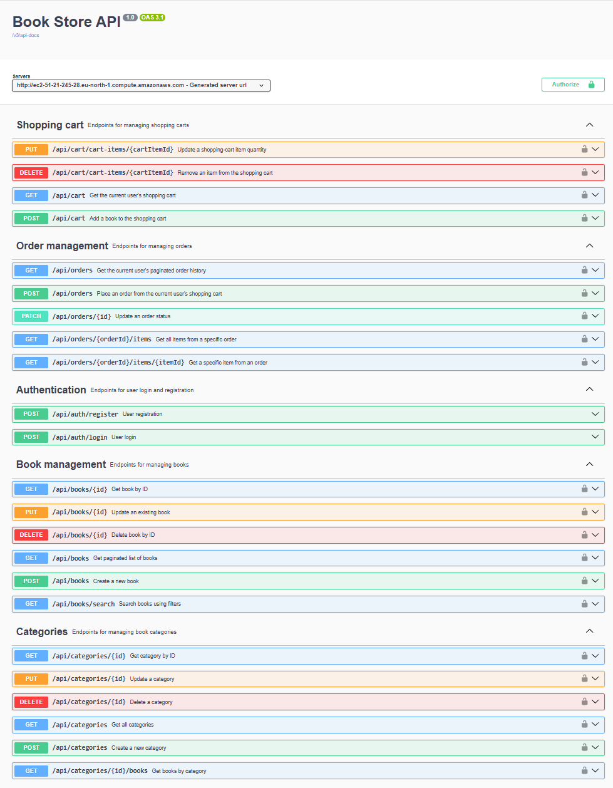
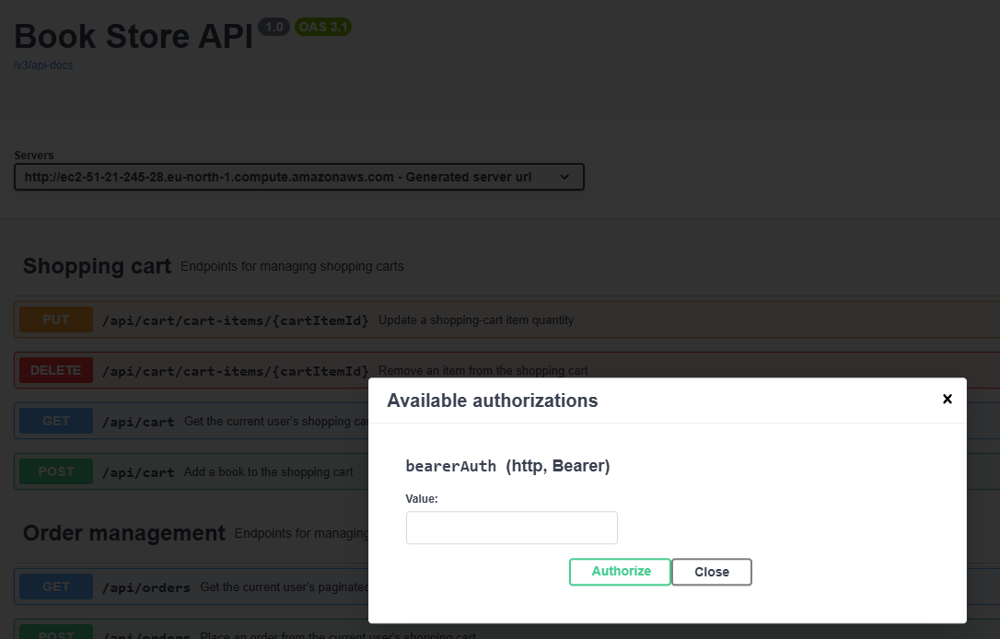
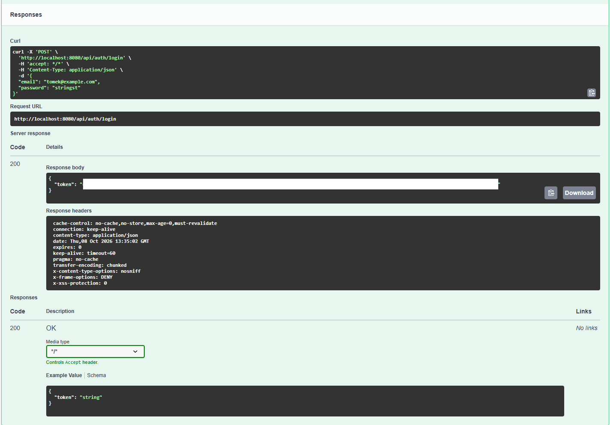

README.md

# 📚 Book Store API


> REST API for an online bookstore built with Java and Spring Boot.
> 
> ## 📸 Screenshots

### Swagger UI



### JWT Authorization



### API Response



## 📖 About the Project

## About the Project

**Book Store API** is a RESTful backend application for an online bookstore.

The project was created as a practical Java backend application to go beyond a simple CRUD implementation and work with technologies and concepts commonly used in commercial backend projects.

The application provides:

- user registration and authentication,
- JWT-based authorization,
- role-based access control,
- book and category management,
- book searching and pagination,
- shopping cart functionality,
- database migrations,
- automated tests,
- OpenAPI / Swagger documentation,
- Docker containerization,
- AWS deployment.

The project is divided into separate application layers:

```text
Controller
    ↓
Service
    ↓
Repository
    ↓
Database
```

Security is handled independently through Spring Security and a JWT authentication filter.
## Live API / Swagger

The application is deployed on AWS EC2 and documented with Swagger UI.

## Main Features

## Authentication

The application implements stateless authentication using JWT.

Features include:

- user registration,

- user login,

- BCrypt password hashing,


- JWT token generation,

- JWT token validation,

- Spring Security authentication,

- role-based authorization,

- protected REST endpoints.

There are two application roles:

USER

ADMIN

Regular users can access the bookstore functionality, while administrators have additional permissions for managing books and categories.

### Default Admin Account

For development and demonstration purposes, the database migration creates a default administrator account:

| Field | Value |
|---|---|
| Email | `admin@bookstore.com` |
| Password | `Admin123!` |
| Role | `ADMIN` |

The administrator account is created automatically by Liquibase when the database is initialized from scratch.

> ⚠️ This account is intended for local development and demonstration purposes. The default password should be changed or removed before using the application in a real production environment.

## Books

The Book API provides:

- retrieving books,

- retrieving a book by ID,

- pagination,

- sorting,

- searching,

- creating books,

- updating books,

- deleting books,

- assigning categories to books.

## Example:

GET /api/books?page=0&size=10

Authenticated users can browse the catalogue.

Administrators can additionally create, update and delete books.

## 🏷️ Categories

The Category API provides:

- retrieving categories,

- creating categories,


- updating categories,

- deleting categories,

- assigning categories to books.

Categories are connected to books through JPA relationships.

## Shopping Cart

Authenticated users can manage their own shopping cart.

Available functionality includes:

- retrieving the current user's cart,

- adding books,

- changing quantities,

- removing cart items.

The application uses the authenticated user rather than accepting an arbitrary user ID from the client.

This prevents a user from simply changing a user ID in the request and accessing another user's shopping cart.

## 🔐 Authentication Flow

```text
Client
  │
  │ POST /api/auth/login
  │ username + password
  ▼
AuthenticationController
  │
  │ Credentials valid
  ▼
JWT Token
  │
  │ Authorization: Bearer <token>
  ▼
JWT Authentication Filter
  │
  │ Validate token
  ▼
Spring Security
  │
  │ Authenticate user
  │
  │ Check role
  ▼
Controller
  │
  ├── USER  → User endpoints
  │
  └── ADMIN → Admin endpoints
```

## 🏗️ Application Architecture

The application follows a layered architecture:

```text
Controller
    ↓
Service
    ↓
Repository
    ↓
Database
```

Security is handled independently through Spring Security and a JWT authentication filter.

## Main Controllers

### AuthenticationController

**Base path:** `/api/auth`

| Method | Endpoint             | Description           | Access |
| ------ | -------------------- | --------------------- | ------ |
| POST   | `/api/auth/register` | Register a new user   | Public |
| POST   | `/api/auth/login`    | Login and receive JWT | Public |

### BookController

**Base path:** `/api/books`

| Method | Endpoint            | Description         | Access |
| ------ | ------------------- | ------------------- | ------ |
| GET    | `/api/books`        | Get paginated books | USER   |
| GET    | `/api/books/search` | Search books        | USER   |
| GET    | `/api/books/{id}`   | Get book by ID      | USER   |
| POST   | `/api/books`        | Create book         | ADMIN  |
| PUT    | `/api/books/{id}`   | Update book         | ADMIN  |
| DELETE | `/api/books/{id}`   | Delete book         | ADMIN  |

The controller uses validation, pagination and role-based method security.

### CategoryController

**Base path:** `/api/categories`

| Method | Endpoint               | Description        | Access |
| ------ | ---------------------- | ------------------ | ------ |
| GET    | `/api/categories`      | Get all categories | USER   |
| POST   | `/api/categories`      | Create a category  | ADMIN  |
| PUT    | `/api/categories/{id}` | Update a category  | ADMIN  |
| DELETE | `/api/categories/{id}` | Delete a category  | ADMIN  |

Category management is protected by authentication and role-based authorization.

### ShoppingCartController

**Base path:** `/api/cart`

| Method | Endpoint                            | Description             | Access |
| ------ | ----------------------------------- | ----------------------- | ------ |
| GET    | `/api/cart`                         | Get current user's cart | USER   |
| POST   | `/api/cart`                         | Add a book to the cart  | USER   |
| PUT    | `/api/cart/cart-items/{cartItemId}` | Update item quantity    | USER   |
| DELETE | `/api/cart/cart-items/{cartItemId}` | Remove an item          | USER   |

The shopping cart is associated with the authenticated user.

## 🛠️ Technologies

| Technology        | Version | Usage                            |
| ----------------- | ------- | -------------------------------- |
| Java              | 17      | Programming language             |
| Spring Boot       | 3.5.4   | Backend framework                |
| Spring Web        | —       | REST API                         |
| Spring Security   | —       | Authentication and authorization |
| JWT / JJWT        | 0.13.0  | Stateless authentication         |
| Spring Data JPA   | —       | Database access                  |
| Hibernate ORM     | —       | ORM / persistence                |
| MySQL             | 8.0     | Relational database              |
| Liquibase         | 4.31.1  | Database migrations              |
| H2                | —       | Test database                    |
| MapStruct         | —       | DTO mapping                      |
| Lombok            | —       | Boilerplate reduction            |
| Springdoc OpenAPI | 2.8.17  | Swagger / API documentation      |
| JUnit             | —       | Testing                          |
| Mockito           | —       | Unit testing                     |
| MockMvc           | —       | Controller testing               |
| Maven             | —       | Build and dependency management  |
| Checkstyle        | —       | Code quality                     |
| Docker            | —       | Containerization                 |
| Docker Compose    | —       | Local development environment    |
| AWS EC2           | —       | Application hosting              |
| AWS RDS           | —       | Production database              |
| Amazon ECR Public | —       | Docker image registry            |

## 🗄️ Database

The project uses **MySQL 8.0** as the main relational database.

Database access is implemented using:

* Spring Data JPA,
* Hibernate,
* JPA entity relationships,
* repositories,
* Liquibase migrations.

Liquibase manages database changes using versioned changesets.

This makes database changes reproducible across different environments.

## ☁️ Production Architecture

The production application is deployed to AWS using Docker on an EC2 instance and connects to an AWS RDS MySQL database.

```text
AWS EC2
    │
    │ Docker
    ▼
Book Store API
    │
    │ JDBC
    ▼
AWS RDS
    │
    ▼
MySQL
```

Database credentials are supplied at runtime and should never be committed to the repository.

## 🧪 Testing

The project contains tests covering the main application layers.

### Repository Tests

Repository tests verify database operations using an H2 test database.

### Service Tests

Service tests use Mockito to isolate business logic from repositories and verify service behavior.

### Controller Tests

REST controllers are tested using MockMvc.

Security-related scenarios include:

* authenticated users,
* different user roles,
* protected endpoints,
* CSRF handling where required,
* service interactions.

## 🧪 Running Tests

The project uses Maven to run automated tests.

### Windows (PowerShell / CMD)

Run all tests:

```bash
.\mvnw.cmd test
```

Run a clean build and verify the project, including tests:

```bash
.\mvnw.cmd clean verify
```

### macOS / Linux

Run all tests:

```bash
./mvnw test
```

Run a clean build and verify the project, including tests:

```bash
./mvnw clean verify
```

## 📖 API Documentation

The project uses Springdoc OpenAPI to generate interactive API documentation.

* **Local:** [Swagger UI](http://localhost:8080/swagger-ui/index.html)
* **Production:** [Swagger UI](http://ec2-51-21-245-28.eu-north-1.compute.amazonaws.com/swagger-ui/index.html)

```text
Bearer <your-token>
```

6. Execute protected endpoints.

## 🐳 Docker

The application is containerized using Docker.

Docker Compose is used to run the application together with MySQL in the local development environment.

### Run with Docker Compose

```bash
docker compose up --build
```

The application will be available at:

http://localhost:8080

To stop the containers:

```bash
docker compose down
```

## ☁️ AWS Deployment

The application is deployed to AWS using Docker, Amazon ECR Public, EC2 and RDS.

The deployment flow is:

```text
Local Project
    │
    │ Docker build
    ▼
Amazon ECR Public
    │
    │ Docker image
    ▼
AWS EC2
    │
    │ Docker
    ▼
Book Store API
    │
    │ JDBC
    ▼
AWS RDS
    │
    ▼
MySQL
```

### Docker Image

The deployed Docker image is stored in Amazon ECR Public:

```text
public.ecr.aws/c5q4d8k8/bookstore-api:v02
```

### EC2 Configuration

The EC2 instance exposes the application through port 80 and forwards traffic to the Spring Boot application running on port 8080 inside Docker.

```text
EC2 port 80
    ↓
Docker port 8080
    ↓
Spring Boot application
```

Database credentials are supplied at runtime and are not stored in the repository.

## 💻 Local Setup

### Requirements

Before running the project, install:

* JDK 17,
* Docker Desktop,
* Git.

Maven Wrapper is included in the project, so a separate Maven installation is not required.

### Clone the Repository

```bash
git clone https://github.com/slawomir-pacek/book-store.git
cd book-store
```

### Run with Docker Compose

```bash
docker compose up --build
```

The API will be available at:

http://localhost:8080

Swagger UI:

http://localhost:8080/swagger-ui/index.html

### Run from IntelliJ IDEA

The application can also be started directly from IntelliJ IDEA.

Make sure the database is available and configure the datasource for the selected environment.

Run:

```text
BookStoreApplication
```

The application starts on:

```text
http://localhost:8080
```

## 🔐 Security Configuration

Spring Security provides:

* stateless session management,
* JWT authentication,
* custom `UserDetailsService`,
* BCrypt password encoding,
* JWT authentication filter,
* method-level security,
* role-based authorization.

Public endpoints include:

```text
/api/auth/register
/api/auth/login
/swagger-ui/**
/v3/api-docs/**
```

Other endpoints require authentication.

Administrative operations require the `ADMIN` role.

## 🧩 Technical Implementation

### Database Migrations

Used Liquibase changesets to version database schema changes and apply them consistently across environments.

### Testing

Implemented automated tests for controllers and services using JUnit, Mockito, MockMvc and Spring Security Test.

### Environment Configuration

Configured database connectivity for different environments, using a local MySQL container during development and Amazon RDS in production.

### AWS Deployment

Built a Docker image, published it to Amazon ECR Public and deployed the Spring Boot application to Amazon EC2, connected to an Amazon RDS MySQL database.

## Project Links

## Live Swagger

[http://ec2-51-21-245-28.eu-north-1.compute.amazonaws.com/swagger-ui/index.html](http://ec2-51-21-245-28.eu-north-1.compute.amazonaws.com/swagger-ui/index.html)
